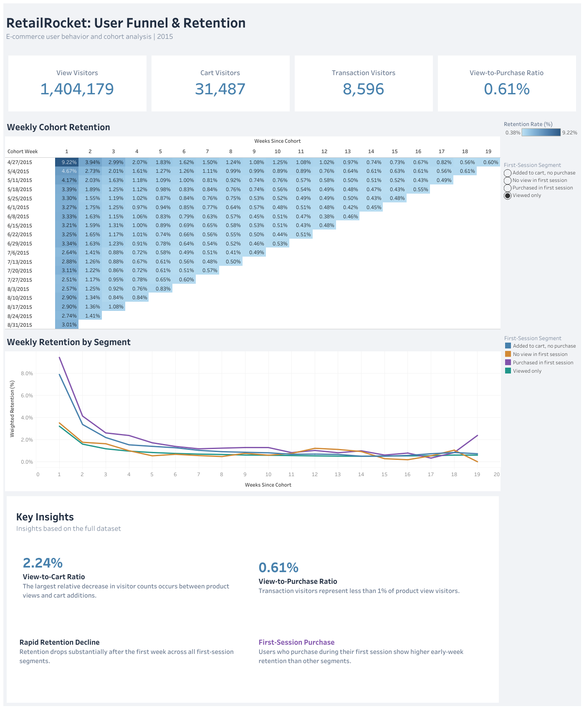

# RetailRocket Product Analytics

## Project Overview

An e-commerce product analytics project focused on user behavior, funnel metrics, weekly cohort retention, and user segmentation.

The project uses Python for data acquisition and validation, PostgreSQL for data processing and analysis, and Tableau for interactive data visualization.

The main objective is to identify patterns in user behavior, evaluate purchasing activity, and understand how first-session behavior is associated with subsequent user retention.

## Business Questions

### Main business question:

At which stage of the user journey does the largest decrease in visitor counts occur, and which user segments are more likely to return?

### Supporting questions:

- What are the key visitor metrics and funnel ratios?
- Between which funnel stages is the largest relative decrease in visitor counts observed?
- How does weekly user retention change over time?
- How does first-session behavior relate to subsequent user retention?

## Dataset

The project is based on the [RetailRocket Recommender System Dataset](https://www.kaggle.com/datasets/retailrocket/ecommerce-dataset), which contains historical e-commerce user interactions from 2015.

The analysis focuses on three types of events:

- `view` — product views.
- `addtocart` — products added to the shopping cart.
- `transaction` — completed purchase events.

Raw data is excluded from the repository.

## Tools & Technologies

- Python — data acquisition and validation.
- SQL (PostgreSQL) — data transformation, funnel analysis, cohort analysis, and user segmentation.
- Tableau Public — interactive dashboard and data visualization.

## Methodology

### 1. Funnel Analysis

Calculated unique visitor counts for product views, cart additions, and transactions.

The following ratios were calculated:

- View-to-Cart Ratio
- Cart-to-Purchase Ratio
- View-to-Purchase Ratio

### 2. User Segmentation

Users were divided into four segments based on their first-session behavior:

- Viewed only
- Added to cart, no purchase
- Purchased in first session
- No view in first session

### 3. Weekly Cohort Analysis

Users were grouped into weekly cohorts to analyze retention over time and compare behavioral patterns across segments.

Weighted retention was calculated as:

**Retention Rate = SUM(Retained Visitors) / SUM(Cohort Size)**

This approach accounts for differences in cohort and segment sizes instead of averaging individual retention percentages.

### 4. Data Visualization

An interactive Tableau dashboard was developed to present:

- KPI cards with key visitor metrics.
- Weekly cohort retention heatmap.
- Retention trends by first-session segment.
- Interactive segment filtering.
- Customized tooltips with cohort sizes, retained visitors, and retention rates.
- Key analytical insights.

## Key Metrics

| Metric | Value |
|---|---:|
| View Visitors | 1,404,179 |
| Cart Visitors | 31,487 |
| Transaction Visitors | 8,596 |
| View-to-Cart Ratio | 2.24% |
| Cart-to-Purchase Ratio | 27.30% |
| View-to-Purchase Ratio | 0.61% |

## Key Insights

- The largest relative decrease in visitor counts occurs between product views and cart additions, with a view-to-cart ratio of 2.24%.
- Transaction visitors represent less than 1% of product view visitors.
- Weekly retention declines substantially after the first week across all first-session segments.
- Users who purchase during their first session demonstrate the highest early-week retention.
- Users who add products to their cart without completing a purchase also show higher early-week retention than users who only view products.

## Business Recommendations

- Investigate potential barriers between product views and cart additions.
- Analyze product page usability and add-to-cart behavior.
- Explore re-engagement strategies during the first weeks after a user's initial session.
- Evaluate personalized retention strategies for different behavioral segments.

These recommendations represent opportunities for further investigation rather than confirmed causal relationships.

## Dashboard

The interactive Tableau dashboard provides an overview of key product metrics, weekly cohort retention, and behavioral segmentation.

[View Interactive Dashboard on Tableau Public](https://public.tableau.com/app/profile/olena.vystavna/viz/retailrocket_product_analytics/RetailRocketUserFunnelRetention)

## Repository Structure

- `data/processed/` — processed datasets used for visualization.
- `sql/` — SQL queries for data processing and analysis.
- `scripts/` — supporting scripts.
- `dashboard/` — Tableau workbook and dashboard preview.
- `docs/` — project documentation.
- `README.md` — project overview and analytical findings.

## Analysis Limitations

- Funnel ratios are based on unique visitor counts at each stage and should not be interpreted as strictly sequential conversion rates without additional event-sequence validation.
- Retention comparisons are observational and do not establish causality.
- Later retention periods may include fewer eligible cohorts due to the limited observation window.
